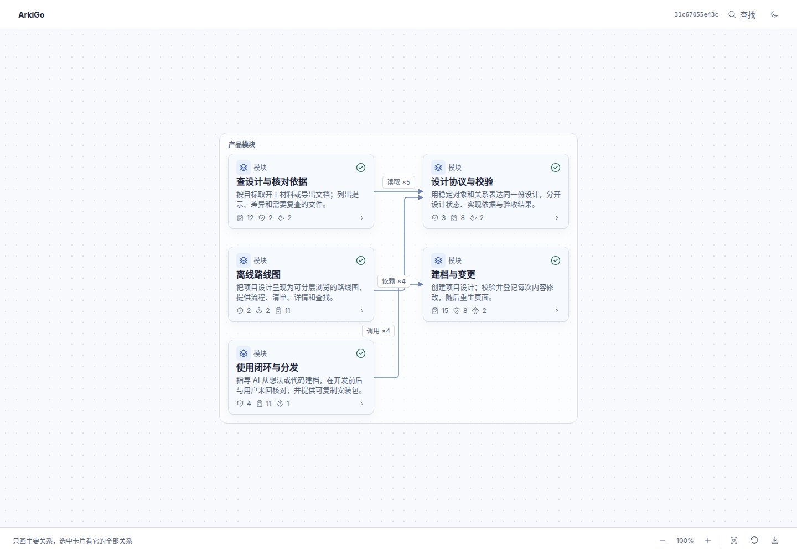

<h1 align="center">ArkiGo</h1>

<p align="center"><strong>给 AI 编程助手用的项目设计 Skill</strong></p>

<p align="center">
  把需求、模块、流程和验收维护在同一份设计里，<br>
  你用离线路线图看全局，AI 开工前读设计，做完回写代码依据和验收结果。
</p>

<p align="center">
  <a href="#开始使用">安装 Skill</a> ·
  <a href="https://github.com/zhuogo/ArkiGo/releases/latest/download/index.html">下载离线演示</a> ·
  <a href="https://github.com/zhuogo/ArkiGo/releases/latest">发行说明</a>
</p>

<picture>
  <source media="(prefers-color-scheme: dark)" srcset="docs/assets/arkigo-map-dark.jpg">
  
</picture>

## 开始使用

快速安装需要 Node.js 22.20 或更高版本，以及支持 Skill 的 AI 编程助手。

```sh
npx skills add zhuogo/ArkiGo --skill arkigo -g
```

安装后，在项目里给 AI 一句任务。也可以[手动安装](skills/arkigo/README.md#手动安装)。

| 你现在的情况 | 可以这样说 |
| --- | --- |
| 手上有个想法 | 用 ArkiGo 整理这个想法，写清目标、范围和主流程，把需要我决定的问题列出来。 |
| 接手已有项目 | 用 ArkiGo 沿着代码整理模块和流程，标出依据的文件和还没核实的地方。 |
| 要改一个功能 | 用 ArkiGo 读相关规则和验收，按确认后的设计实现，做完回写代码位置和实际验收结果。 |

AI 生成设计后，双击项目里的 `docs/arkigo/index.html`。上面的离线演示是 ArkiGo 自身的路线图，下载后可以直接打开。

## 在路线图里看项目

顺着地图看模块和关系，点击卡片查看职责、流程和关联文件。用顶栏查找对象、沿层级进入模块，或按类型浏览清单。待定问题可以在详情中阅读，确认后在对话里告诉 AI。

地图上的带勾圆圈表示生成页面时，已登记的代码依据全部匹配。虚线圆圈表示待核对。具体依据在卡片详情里。


## 让设计和代码一起更新

- **确认设计。** 需求、规则、数据、接口和验收放进 `docs/arkigo/design.json`，每项内容都有来源。AI 的提议和你确认的决定各有状态。
- **按设计开发。** AI 用 `context` 读取本次要用的规则、接口和验收，用 `change` 记录实现位置和实际验收结果。
- **复查代码依据。** `verify` 检查登记过的文件是否变化或缺失，提示哪些设计需要复查。

把整个 `docs/arkigo/` 和代码一起提交，下次就能按同一份设计继续开发。

## 从 1.x 升级

2.x 使用 `arkigo/2`。可以让 AI 把旧版 `canvas.json` 当作资料，整理出新的设计，然后核对原有规则和流程的落点。

## 开发与许可

[维护说明](skills/arkigo/README.md) · [Skill 指引](skills/arkigo/SKILL.md) · [MIT 许可证](LICENSE)
