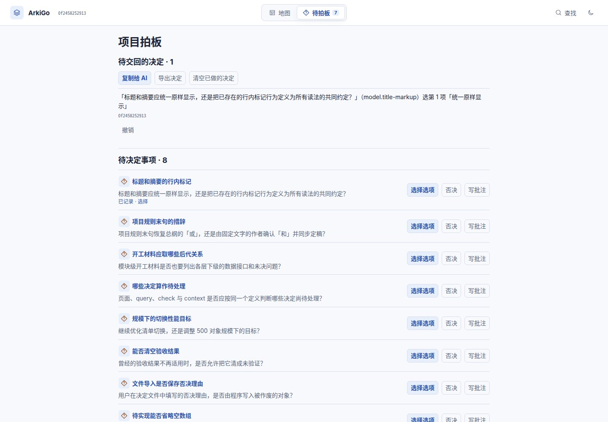

# ArkiGo

**一个项目，一份活的设计。你在页面上看懂和拍板，AI 按它写代码，再把做到哪了写回来。**

AI 写代码很快，难的是让它一直按你的意思写：需求散在聊天记录里，设计文档写完就过时，代码改过几轮之后，没人说得清项目现在是什么样。

ArkiGo 是给 AI 编程助手用的一个 Skill（技能包）。它把项目的目标、模块、流程、规则、数据、接口、验收和还没定的问题收进一份设计文件：AI 用命令维护它，你用一个离线网页阅读、批注和拍板。写代码前 AI 从这里取材料，写完把依据的代码位置写回来；之后代码变了，它能指出哪些设计需要复查。

<picture>
  <source media="(prefers-color-scheme: dark)" srcset="docs/assets/arkigo-map-dark.jpg">
  
</picture>

## 你可以用它做什么

- **只有一个想法**。让 AI 先整理目标、范围和主流程，把会影响方案的问题留给你选。
- **已经有一个项目**。让 AI 沿着实际代码整理模块和运行流程，写明它读过的文件与仍有疑问的地方。
- **继续开发或改功能**。让 AI 先取相关规则、接口、验收和实现依据，按确认后的设计开发，再回写结果。

## 一张地图，两个入口

| 在哪里 | 看什么 |
| --- | --- |
| 地图 | 看项目分成哪几块、主要怎么连。点一块，旁边就是它的详情：职责、里面有什么、相关关系和依据。进入模块看内部，进入流程看一件事从触发到结束、在哪里分支、失败后怎么办。 |
| 待拍板 | 处理提议和待定项，把选择、理由与批注交回给 AI。 |
| 查找 | 搜标题、内容或依据，或者按目录找；也从这里按类型列出全部规则、验收、数据、接口和界面。 |
| 实现情况 | 地图标题下的一行数字，点开看各模块的实现状态、验收结果和需复查的依据。 |
| 版本号 | 点开看每次改了什么、为什么改，对照字段的前后值。 |




## 它怎样保持是真的

设计内容可以追溯到用户的话、文档、已有代码或明确标出的 AI 提议。「提议」「已接受」「已作废」记录这项设计的决定状态。还没定的问题单独列出选项，等你拍板。AI 读过代码才登记实现依据，实际执行过才回写验收结果。依据文件内容变化或缺失时，ArkiGo 会提示 AI 重新核对。

## 开始使用

安装到支持 Skill 的编程助手环境。

```sh
npx skills add zhuogo/ArkiGo --skill arkigo -g
```

运行命令需要 Node.js 22 或以上。首次使用时，AI 会按技能指引检查运行依赖。也可使用[手动安装说明](skills/arkigo/README.md#手动安装)。

安装后，在你的项目里对 AI 说：

> 用 ArkiGo 把这个想法整理成设计。先写目标、范围和主要流程，把需要我决定的问题列出来。我的想法是：……

> 用 ArkiGo 帮我看懂这个项目。沿真实代码整理主要模块和流程，标出依据的文件和符号，以及你还没核实的地方。

> 用 ArkiGo 改这个功能：……。先读相关规则和验收，需要调整设计时先写入，再实现和验证。做完回写代码位置和实际验收结果。

> 我已经在 ArkiGo 的「待拍板」里做了决定。请核对我看到的版本，把下面的决定写进设计，并逐条处理批注。……（粘贴「复制给 AI」的内容，或附上「导出决定」得到的文件。）

AI 生成设计后，双击项目里的 `docs/arkigo/index.html` 打开。设计重新生成后刷新页面。

## 看一个真实的例子

[ArkiGo 自己的设计](docs/arkigo/index.html)里有这套工具的模块、命令、工作流程、实现依据和待定项。下载仓库后，双击 `docs/arkigo/index.html` 浏览。

## 使用时需要知道

- 页面支持阅读、批注、拍板和拖动卡片。内容修改经由 AI 调用命令写入，然后重新生成页面。
- AI 的提议需要你确认。待拍板里的操作先保存在当前浏览器，交给 AI 写入后才进入项目设计。
- 「已实现」表示 AI 或维护者读过对应代码，确认它做到了这项设计；验收是否通过另行记录。
- 把整个 `docs/arkigo/` 和代码一起提交，便于下一轮找到设计、修改记录和依据。
- 页面可离线打开。设计引用了图片时，把设计目录中的 `assets/` 一起带上。

## 从 1.x 升级

2.0 使用 `arkigo/2`，与 1.x 格式不兼容，也没有转换程序。让 AI 用 2.0 技能把旧 `canvas.json` 当作资料，从头整理到新的设计目录，再核对原有规则和流程的落点。

## 许可证

[MIT](LICENSE)
