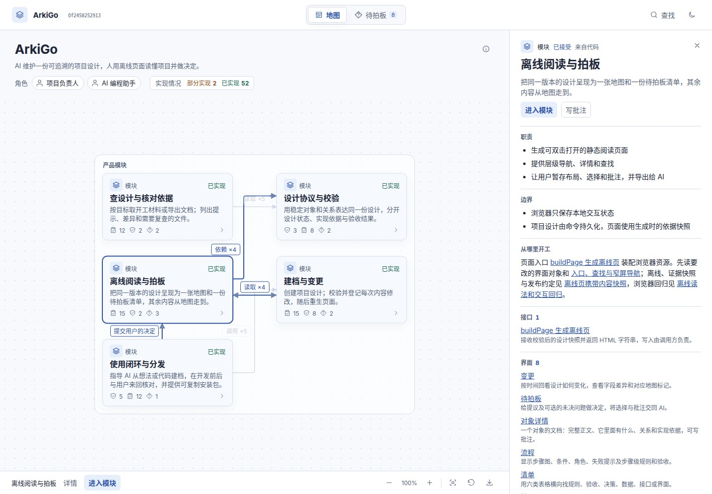

<h1 align="center">ArkiGo</h1>

<p align="center"><strong>为 AI 编程项目维护一份可浏览、可追溯的设计</strong></p>

<p align="center">
  你在离线路线图上看需求、模块和流程。<br>
  AI 开工前读取相关规则和验收，做完回写代码位置和测试结果。
</p>

<p align="center">
  <a href="#开始使用">快速安装</a> ·
  <a href="https://github.com/zhuogo/ArkiGo/releases/latest/download/index.html">下载离线演示</a> ·
  <a href="https://skills.sh/zhuogo/arkigo/arkigo">在 skills.sh 查看</a>
</p>

## 开始使用

```sh
npx skills add zhuogo/ArkiGo --skill arkigo -g
```

使用 Node.js 22.20 或更高版本。安装时选择你的 AI 编程助手，例如 Codex 或 Claude Code。全局安装后，各项目都可以调用 ArkiGo。[手动安装](skills/arkigo/README.md#手动安装)

<a href="https://github.com/zhuogo/ArkiGo/releases/latest/download/index.html">
  <picture>
    <source media="(prefers-color-scheme: dark)" srcset="docs/assets/arkigo-map-dark.jpg">
    
  </picture>
</a>

## 在项目里试一次

安装后，在项目目录里打开一个新的 AI 对话。已有代码时，可以先让 AI 整理项目。

> 用 ArkiGo 梳理这个项目。沿现有代码画出主要模块和流程，标出依据的文件，把需要我确认的问题列出来。

想从零开始，可以请 AI 整理目标、范围和主流程。要继续开发，可以请 AI 先读对应模块的规则和验收，再实现并回写结果。

生成后，双击项目里的 `docs/arkigo/index.html`。点击模块看职责和关联文件，沿地图上的连线找依赖，也可以按标题、内容或代码依据查找。确认待定问题后，在对话里把决定告诉 AI。



## 设计怎么跟着代码更新

项目的需求、规则、数据、接口和验收集中在 `docs/arkigo/design.json`。把整个 `docs/arkigo/` 与代码一起提交，下一次开发就能接着用。

| 时机 | ArkiGo 提供什么 |
| --- | --- |
| 开工前 | `context` 读取这次要用的设计、规则、接口和验收。 |
| 做完后 | `change` 记录代码位置、实际验收结果和你确认的决定。 |
| 代码变动后 | `verify` 提示哪些登记过的依据文件发生变化或缺失。 |

路线图用带勾和虚线圆圈表示依据在生成时的核对状态。点开详情可查看具体文件。

## 升级与维护

从 1.x 升级时，可以让 AI 用旧 `canvas.json` 整理出 `arkigo/2` 格式的设计，再核对原先的规则和流程。

[发行说明](https://github.com/zhuogo/ArkiGo/releases/latest) · [维护说明](skills/arkigo/README.md) · [Skill 指引](skills/arkigo/SKILL.md) · [MIT 许可证](LICENSE)
