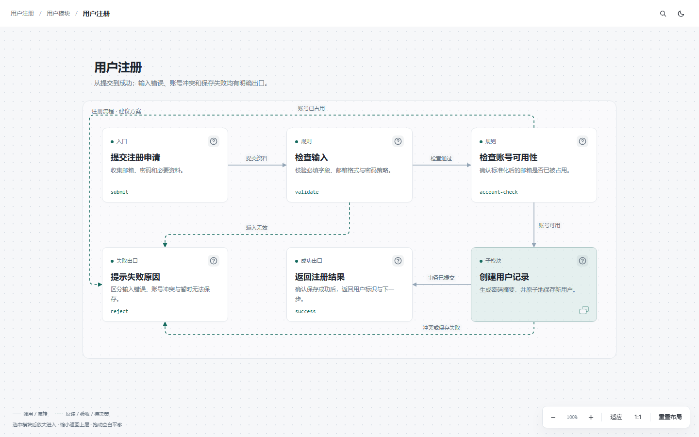

<div align="center">

# ArkiGo

**跟 AI 聊想法，用一张图看懂项目。**

把想法或已有项目，变成可以逐层探索的交互式系统架构图。

[开始使用](#开始使用) · [先体验示例](#先体验示例) · [使用文档](./skills/arkigo/README.md)

</div>

```sh
npx skills add zhuogo/ArkiGo --skill arkigo -g
```

一行安装到你的 AI 助手。需要 Node.js 22.20+ 和 Git；不熟悉命令也可以[让 AI 帮你安装](#1-安装-arkigo)。

<picture>
  <source media="(prefers-color-scheme: dark)" srcset="./docs/assets/architecture-dark.png">
  
</picture>

*实际画布截图 · 用户注册设计示例。先看全局，再进入模块，逐层看清细节。*

## 你可以用它做什么？

「我有一个想法，但不知道怎么拆成具体功能。」

「AI 写了不少代码，可我还没弄明白这个项目是怎么运作的。」

「我想改一个功能，应该先看哪一部分？」

把这些问题交给 ArkiGo。它会引导 AI 梳理项目，把主要模块、协作关系、业务流程和需要确认的问题组织成一张可以探索的项目地图。

| 你现在的情况 | ArkiGo 帮你做什么 |
| --- | --- |
| **只有一个想法** | 和 AI 一起理清要做什么、有哪些功能、哪些问题还没想好 |
| **已经有一个项目** | 让 AI 阅读相关代码，用图说明各部分的职责和运作流程 |
| **准备修改一个功能** | 找到相关模块，讨论规则和异常情况，让 AI 更新设计图 |

**你负责表达需求和确认方向，AI 负责梳理内容，ArkiGo 把它呈现成图。**

## 一张图，怎么看？

- **先看全局**：项目有哪些部分，它们怎样配合。
- **再进入模块**：双击带层叠标记的模块，逐层查看内部结构；点击顶部路径返回上层。
- **点开看细节**：查看这个环节做什么、有哪些规则、失败时怎么办；已有代码的模块还可以记录源码位置。
- **继续和 AI 聊**：哪里不清楚、哪里需要调整，直接提出，让 AI 更新图。

例如，一个注册功能可以这样逐层展开：

**系统全景 → 用户模块 → 用户注册 → 创建用户记录**

生成好的图是一个 HTML 文件，用浏览器就能打开，也可以发给别人离线查看。支持搜索、浅色与深色主题，以及拖动调整布局。

## 开始使用

### 1. 安装 ArkiGo

ArkiGo 是给 AI 助手使用的 **Skill（技能包）**。你的助手需要支持 Skill，并且能读取本地文件、运行命令。

已有 [Node.js 22.20 或以上](https://nodejs.org/) 和 Git？打开终端，运行：

```sh
npx skills add zhuogo/ArkiGo --skill arkigo -g
```

按提示选择你使用的 AI 助手，完成后重新打开会话。`-g` 表示安装到用户目录，以后在不同项目中都能使用。安装由 [skills CLI](https://github.com/vercel-labs/skills) 完成，无需先下载整个仓库。

**第一次画图时，AI 会按 Skill 指引安装运行依赖，需要联网；之后生成和打开图都可离线完成。** AI 对话本身是否需要联网，取决于你的助手。

不熟悉终端，或者不确定环境是否齐全？把下面这段话发给 AI：

```text
请帮我安装 ArkiGo：https://github.com/zhuogo/ArkiGo
先阅读仓库的安装说明，检查所需环境，完成 Skill 和依赖安装，
并确认当前助手可以识别和使用 arkigo。
```

<details>
<summary>更新已安装的 Skill，或使用手动安装</summary>

通过上面的 skills CLI 安装后，可以只更新 ArkiGo：

```sh
npx skills update arkigo -g
```

如果想手动安装，ArkiGo 自身需要 Node.js 22+。以下命令还需要 Git：

```sh
git clone https://github.com/zhuogo/ArkiGo.git
cd ArkiGo
node skills/arkigo/scripts/install.mjs --user
```

安装器会显示安装位置。进入该目录，安装运行依赖：

```sh
npm ci --omit=dev --ignore-scripts --no-audit --no-fund
```

默认安装位置为 `~/.codex/skills/arkigo`；设置了 `CODEX_HOME` 时使用其下的 `skills/arkigo`。其他客户端可把 `--user` 换成该客户端 Skill 目录下的空目标路径。已有目录不会被覆盖。

安装后，确认你的 AI 助手能识别 `arkigo`。完整说明见 [Skill 安装与用法](./skills/arkigo/README.md#运行与安装)。

</details>

### 2. 告诉它，你想看懂什么

不需要先写一份完整需求，也不需要学习画图语法。选一个接近你情况的例子，把内容换成自己的：

**从一个想法开始**

```text
$arkigo 我想做一个个人记账工具，支持记录收支和查看每月统计。
请帮我理清主要功能和使用流程，生成一张能逐层查看的系统架构图。
还没确定的地方请标出来。
```

**看懂已有项目**

```text
$arkigo 请帮我看懂当前项目：它是做什么的，主要模块怎样配合？
先梳理核心流程，生成系统架构图，并记录相关代码的位置。
```

**继续修改设计**

```text
$arkigo 在现有设计里增加“忘记密码”功能。
请先和我确认流程及异常情况，再更新相关模块和系统架构图。
```

### 3. 打开图，边看边聊

请 AI 告诉你生成文件的位置，用浏览器打开其中的 **`canvas.html`**。

看图时，你可以继续说：「这个模块再讲细一点」「这里失败了会怎样」「先去掉这个功能」。让 AI 按你的反馈修改，再刷新页面查看。

默认文件放在你正在设计或分析的项目中：

| 文件 | 用途 |
| --- | --- |
| `docs/canvas.html` | 你打开、浏览和分享的图 |
| `docs/canvas.json` | AI 下次继续修改这张图所需的内容，请一起保留 |

## 先体验示例

还不想安装？可以先 **[下载本仓库](https://github.com/zhuogo/ArkiGo/archive/refs/heads/main.zip)**，解压后双击下面的 HTML 文件，用浏览器体验。

| 示例 | 可以看什么 | 解压后打开 |
| --- | --- | --- |
| **用户注册** | 从系统全景逐层进入注册流程，查看成功和失败分支 | `docs/poc/canvas-engine/registration.html` |
| **任务清单** | 任务新增的主流程与异常分支 | `docs/poc/canvas-engine/tasks.html` |
| **实现情况** | 待实现、部分实现、已实现、未核对四种状态，以及说明和来源 | `docs/poc/canvas-engine/implementation.html` |
| **ArkiGo 自身架构** | 用 ArkiGo 的图了解它自己的画布引擎 | `docs/poc/canvas-engine/index.html` |

示例图可离线打开，无需安装 Skill 或启动服务。「用户注册」和「任务清单」是设计示例，方便你体验图的组织与交互。

## 使用时需要知道

- **改内容，继续找 AI**：目前画布用于查看和调整布局；业务内容通过 AI 修改，浏览器里的拖动只改变布局。
- **AI 的分析需要你确认**：没有核对的地方应标为未知；图中的建议和代码的实际情况需要分别确认。
- **实现状态要有依据**：「已实现」表示按记录的来源核对过，不代表已经测试通过或上线。
- **生成的图可离线查看**：AI 分析、对话是否需要联网，取决于你使用的 AI 助手。

ArkiGo 目前处于早期迭代阶段。欢迎通过 [Issues](https://github.com/zhuogo/ArkiGo/issues) 告诉我们：你想用它看懂什么项目，在哪一步遇到了困难。

## 想了解更多？

- [Skill 安装与完整用法](./skills/arkigo/README.md)
- [画布示例与说明](./docs/poc/canvas-engine/README.md)
- [设计文档](./docs/README.md)
- [开发验证与验收记录](./docs/07-Skill验收.md)
