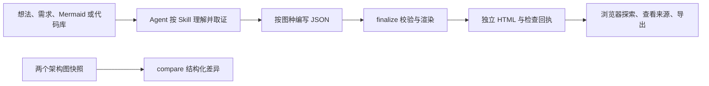

# Archify 研究与借鉴

## 结论

Archify 确实可以让 AI 阅读项目，按源码证据生成交互式架构图。它同时支持从自然语言描述、计划和 Mermaid 开始，因此不能将两者的区别简单归结为“Archify 只能读代码，ArkiGo 才能做前置设计”。

当前快照已经覆盖多种图、源码定位、树形展开、关系探索和架构快照比较。ArkiGo 的重点应放在持续维护的系统设计模型、业务规则与验收、设计和实现的差异，以及同一画布中的语义缩放。

## 研究依据

研究对象：`tt-a1i/archify`，提交 `7e45f36c66de1254d5ad6ba1d878f6499ea269fd`。包声明版本为 `3.2.0`，本地是该提交源码快照，不是发布包安装。

| 已阅读材料 | 支持的结论 |
| --- | --- |
| [中文 README](https://github.com/tt-a1i/archify/blob/7e45f36c66de1254d5ad6ba1d878f6499ea269fd/README_ZH.md)、[产品定位](https://github.com/tt-a1i/archify/blob/7e45f36c66de1254d5ad6ba1d878f6499ea269fd/PRODUCT.md) | 同时接受想法、计划和代码证据，主要交付可独立打开的交互作品 |
| [Skill](https://github.com/tt-a1i/archify/blob/7e45f36c66de1254d5ad6ba1d878f6499ea269fd/archify/SKILL.md) | 规定图种选择、输入生成、验证、交付和失败修复流程 |
| [仓库阅读方法](https://github.com/tt-a1i/archify/blob/7e45f36c66de1254d5ad6ba1d878f6499ea269fd/archify/references/repository-authoring.md) | 固定仓库版本，沿实际调用及读写追踪，记录未知项和源码范围 |
| [架构图 Schema](https://github.com/tt-a1i/archify/blob/7e45f36c66de1254d5ad6ba1d878f6499ea269fd/archify/schemas/architecture.schema.json)、[公共定义](https://github.com/tt-a1i/archify/blob/7e45f36c66de1254d5ad6ba1d878f6499ea269fd/archify/schemas/common.schema.json) | 用结构化 JSON 表示组件、连接、边界、布局和源码引用 |
| [架构渲染器](https://github.com/tt-a1i/archify/blob/7e45f36c66de1254d5ad6ba1d878f6499ea269fd/archify/renderers/architecture/render-architecture.mjs) | 校验输入、计算布局和连线，将组件渲染到图表模板 |
| [CLI](https://github.com/tt-a1i/archify/blob/7e45f36c66de1254d5ad6ba1d878f6499ea269fd/archify/bin/archify.mjs) | 提供渲染、交付、检查和架构比较等入口 |
| [架构差异实现](https://github.com/tt-a1i/archify/blob/7e45f36c66de1254d5ad6ba1d878f6499ea269fd/archify/delta/architecture-delta.mjs) | 按稳定 ID 比较，区分语义、拓扑、证据和几何变化 |
| [视口相机](https://github.com/tt-a1i/archify/blob/7e45f36c66de1254d5ad6ba1d878f6499ea269fd/viewer/viewer-camera.js)、[类别筛选](https://github.com/tt-a1i/archify/blob/7e45f36c66de1254d5ad6ba1d878f6499ea269fd/viewer/semantic-lens.js) | 提供缩放、平移，以及按节点类别查看连接 |
| [树图说明](https://github.com/tt-a1i/archify/blob/7e45f36c66de1254d5ad6ba1d878f6499ea269fd/archify/renderers/tree/README.md)、[树图交互](https://github.com/tt-a1i/archify/blob/7e45f36c66de1254d5ad6ba1d878f6499ea269fd/viewer/tree-branches.js) | 支持单父级树与折叠展开，所检查的树图模型不含跨分支关系 |

结论来自上述说明、Schema 和实现的静态阅读。本轮没有运行生成流程或浏览器验收；不把阅读到的测试或文档承诺当作本机已验证结果。

## 它的核心流程

AI 负责理解和编写候选数据，程序负责确定性校验、布局、渲染和交付。它并不是只靠一段提示词让 AI 随意编写页面。

Skill 的默认原生图流程包括 `validate`、`deliver`、严格 `check` 和真实浏览器 `browser-check`。文档明确区分自动化检查与实际视觉审阅；自动通过不等于所有业务语义正确。

## 值得借鉴的能力

### 结构化数据与确定性程序分工

原生图使用 JSON 中间表示，再交给特定图种的渲染器。当前 Skill 路由列出架构、流程、时序、数据流、生命周期、ERD、树、类、时间线、瀑布图，另有 explainer 页面模式。部分旧说明还出现“五种模式”的表述，应以本次读取的 Skill、Schema 和代码为准。

ArkiGo 应让 AI 主要编辑设计语义，避免每轮迭代重新生成整个画布应用。坐标、路线和展示层应由程序尽可能稳定地处理。

### 来源证据有具体边界

仓库模式要求固定仓库 URL 与提交，追踪实际调用、读写和执行位置，而不是从目录名推测模块行为。它将源码范围挂在主要节点上；所检查的协议没有给关系独立挂 `sources`。

源码引用能证明引用位置及字节存在，不能独自证明 AI 对业务含义的解释一定正确。ArkiGo 应进一步支持针对规则和关系的证据，以及无 Git 的本地快照。

### 架构变更已有实现

`architecture-delta.mjs` 按组件和连接的稳定 ID 比较两个架构快照：

- 组件区分语义、来源证据、位置与尺寸。
- 连接区分端点、语义和路线变化。
- 边界以 `kind + label` 推导身份，存在改名导致身份变化的限制。
- 输出明确说明：比较的是作者提供的架构数据，不推导真实运行时影响、风险或可合并性。

ArkiGo 可以借鉴字段分类，但比较范围还需包含业务规则、验收条件、待决策问题、设计状态及实现证据。影响分析也必须说明基于哪些已记录关系。

### 交互能力不等于我们目标中的语义缩放

所检查的相机代码主要控制缩放与平移；Semantic Lens 按类别筛选关系；树图通过显式操作折叠后代。它们各有价值，但不能据此认定已实现“缩远为模块盒子，放大后在盒子内显现子模块、流程与规则”的完整交互。

在本次检查的架构 Schema 中，组件没有通用的 `parentId + 多层内容表示` 契约。这里是对已检查范围的判断，不是对所有社区扩展作全面否定。

## ArkiGo 的设计选择

| 方面 | Archify 当前材料体现的重点 | ArkiGo 建议重点 |
| --- | --- | --- |
| 工作单元 | 某次请求的一张图或一页作品 | 一个项目持续维护的设计工作区 |
| 数据 | 各图种的结构化描述 | 共享设计对象，派生不同视图 |
| 深入阅读 | 节点详情、路径、筛选和树形折叠 | 同一对象按尺度呈现摘要、结构、行为和证据 |
| 设计内容 | 部件、步骤、关系、状态及说明 | 增加目标、规则、问题、验收与决策之间的明确关系 |
| 变更 | 架构图快照比较 | 设计变化、布局变化、实现观察变化分别记录 |
| 代码关联 | 提交固定的仓库证据 | 规划中的位置与已观察的位置分开，支持快照取证 |

## 复用策略

首版独立定义模型，不直接把 Archify 的架构 Schema 当作全部产品数据。它服务的是一张架构图，缺少 ArkiGo 所需的部分业务对象和跨视图身份。

优先借鉴流程和契约；后续可做导出适配器，把某个视图投影成 Archify JSON，生成分享图。投影必须列明未表达的规则、附件和关系，不能声称导出图与完整设计等价。

若实际复制运行时代码，需要保留适用的许可证、版权和修改说明。当前根目录 [NOTICE](https://github.com/tt-a1i/archify/blob/7e45f36c66de1254d5ad6ba1d878f6499ea269fd/NOTICE) 说明默认 Apache-2.0，同时保留历史 MIT 授权及其他组件条款，不能因为存在 `LICENSE-MIT` 就把整个当前快照视为 MIT。
