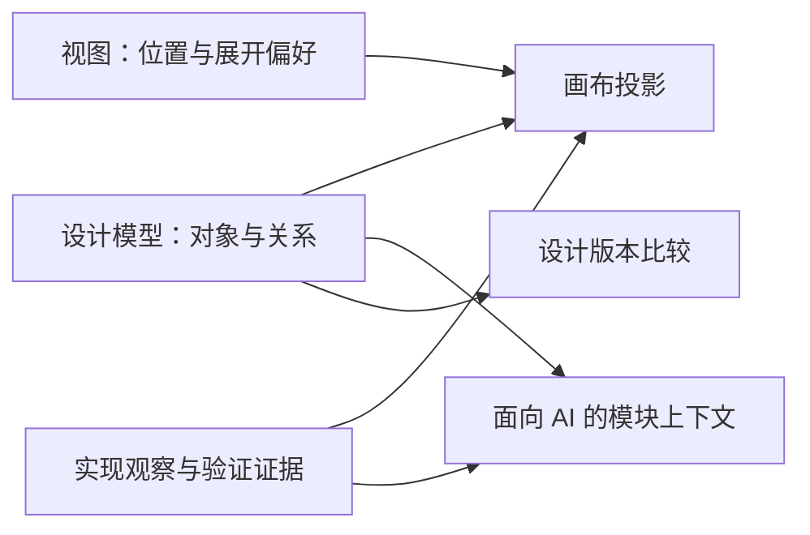

# 设计模型与文件协议

状态：`0.1-draft` 设计协议；起步范围内的 [Schema](../skills/arkigo/schemas/model-0.1-draft.schema.json) 与 [validate](../skills/arkigo/scripts/validate.mjs) 已实现。校验的具体约定与边界见[工具说明](../skills/arkigo/README.md)。迁移程序及超出起步范围的协议仍未实现。

> 2026-11-12：[起步范围](./00-起步范围.md)只采用本文件的对象模型、关系、结构与流程校验，以及 `content`、`structure`、`relationship`、`decision` 四类差异。视图文件、实现证据、`history/`、附件、变更回执和并发检查已推迟。

## 内容、视图和证据分开

模型保存“系统被设计成怎样”，视图保存“怎样展示”，实现证据保存“在某个代码版本实际观察到什么”。它们通过稳定 ID 连接。



画布页面和 AI 摘要是派生产物，不作为第二份独立设计来源。修改导出的 HTML 不会自动改变模型；后续若提供画布编辑，必须通过同一模型更新入口持久化。

## 最小对象模型

一个项目包含 `schemaVersion`、`project`、`revision`、`nodes`、`relations`。`project` 保存项目 ID、名称、目标、范围和关键假设。`revision` 是每次更新产生的新版本标识；生产工具负责分配，样例使用易读标识。

所有对象具有：

| 字段 | 含义 |
| --- | --- |
| `id` | 在该项目内永久唯一，改名、移动、调整视图时不改变 |
| `kind` | 对象类型 |
| `title`、`summary` | 标题与短摘要；摘要不能与详细规则矛盾 |
| `parentId` | 唯一结构归属，系统根节点为 `null`；不是调用或业务依赖 |
| `designStatus` | `proposed`、`accepted` 或 `retired`，仅描述设计决策状态 |
| `provenance` | `origin` 与来源引用，区分用户、AI、代码、导入和演示样例 |
| `details` | 按对象类型保存完整语义 |
| `attachments` | 可选附件列表；包括资源位置、类型、标题和替代说明 |

`origin` 初始取值为 `user`、`ai`、`code`、`import`、`example`。来源不等于确认状态：用户提出一个探索方向也可能仍是 `proposed`；代码里的行为也未必是目标设计。

### v0.1 对象类型

| `kind` | `details` 关键内容 |
| --- | --- |
| `system` | 服务对象、范围内外的内容、成功标准 |
| `module` | 职责、边界、输入、输出 |
| `flow` | 触发条件、前置条件、`startStepId`、`terminalStepIds` |
| `step` | 执行动作、输入输出、失败处理；分支由关系表达 |
| `rule` | 适用条件、约束、例外与理由，禁止只写“合理处理” |
| `acceptance` | `given`、`when`、`then`；表示预期，不表示已经执行 |
| `question` | 待决策问题、可选方案、阻塞的工作范围 |

`decision`、`contract`、`entity`、`state` 可在后续版本成为专门类型。首版需要这些信息时可在所属对象的 `details` 中清楚记录，但不得宣称已经支持完整状态机或接口一致性校验。

## 层级和关系

`parentId` 构成无环的归属树，帮助导航。关系构成有类型的有向图，表达跨层级语义。首版不再保存一套重复的 `contains` 边，避免父子关系出现两份不一致的数据。

一个对象可在多个视图出现，但只有一个 ID 和一份语义内容。权限规则可以归属权限模块，再通过关系约束多个业务流程，不需要复制规则。

关系具有 `id`、`kind`、`from`、`to`、可选 `label`、`condition`、`provenance`。

| `kind` | 方向和含义 |
| --- | --- |
| `depends_on` | A → B：A 的设计依赖 B |
| `governed_by` | 流程或步骤 → 规则：该行为受规则约束 |
| `verifies` | 验收 → 被验证的流程、步骤或规则 |
| `next` | 步骤 → 步骤：流程流转，可附分支条件 |
| `questions` | 问题 → 被影响的设计对象 |

以后增加 `calls`、`reads`、`writes` 等关系时，必须定义方向、允许的端点与证据要求。不能将所有关系都解释为依赖，也不能把图上的连线自动当作真实调用。

## 设计和实现使用不同状态

设计已被接受，不意味着已有代码；已有代码，也不意味着符合当前设计。实现记录位于独立的 `evidence/` 数据中，关联 `nodeId` 与对应设计对象的内容指纹。

| 实现记录 | 需要的依据 |
| --- | --- |
| `planned` | 建议目录或符号，明确位置可能尚不存在 |
| `observed` | 已读取的代码路径、版本和内容摘要；仅说明观察到实现线索 |
| `verified` | 对应验收的结果、检查方法、代码版本及设计内容指纹 |
| `stale` | 路径、内容或设计已变，原证据不再适用 |
| `unknown` | 尚未获取或无法判定，不能推导为未实现 |

这些是单条记录的状态。模块摘要应展示覆盖数量和缺口，不因找到一个函数就将整个模块标为已验证。所有“通过”必须能指向具体验收及版本。

代码定位建议包含：`repoId`、项目内相对 `path`、可选 `symbol`、行号范围、内容摘要和取证时间。行号只是定位提示；文件改动后需用符号及内容重新验证，不能假设旧行号仍正确。

Git 项目可以固定提交；有未提交修改时另记实际文件内容摘要，不能把工作区内容冒充 HEAD。无 Git 项目使用文件摘要和快照身份，不伪造提交。本地 Archify 参考快照就是后一种实际场景。

## 用户项目的文件布局

以下是未来在用户项目中生成的工作区，不是当前参考资源目录：

```text
<user-project>/
  .arkigo/
    model.json                 # 当前基线设计
    views/main.json            # 坐标、布局、展开偏好
    proposals/<change-id>/
      base.json                # 此次修改的设计基线
      candidate.json           # 候选设计
      request.md               # 这次为什么修改
      delta.json               # 程序计算的对象与字段差异
    history/<revision>/        # 按需要保存的设计快照与变更回执
    evidence/                  # 代码观察与验收结果
    assets/                    # 图片等项目附件
    generated/                 # 可再生成的 HTML、索引和摘要
```

JSON 为首版机器交换格式；较长说明可作为 Markdown 附件。媒体以项目内相对路径保存。分享时检查资源是否可搬运；本地绝对路径不能成为分享包的依赖。

设计历史属于用户项目的迭代记录，与“参考库只保留一份最新源码”的要求是两回事。记录轻量模型和资源摘要即可，不为每次设计变化复制整个代码库或媒体目录。

## 更新和一致性

1. 读取当前版本与内容指纹，为修改保存明确基线。
2. 在候选文件中按 ID 修改对象，保留无关内容和布局。
3. 校验候选，再由程序比较基线和候选，生成差异；AI 的文字说明不能替代实际差异。
4. 应用前重新比较当前基线指纹；发生并发变化时报告冲突，不覆盖他人改动。
5. 先准备快照与变更回执，再原子替换当前模型文件。回执记录基线与目标指纹，崩溃恢复时按当前指纹判定是否应用，不能仅凭回执存在判断成功。
6. 基于已应用的模型重新生成视图与上下文；旧证据只对内容未变化的对象继续适用。

差异分类至少包括 `content`、`structure`、`relationship`、`decision`、`evidence`、`layout`。布局变化来自视图文件，证据变化来自证据文件，不混入“业务规则修改”计数。对象重命名属于内容变化，归属调整属于结构变化，稳定 ID 不变。

拆分或合并模块需要显式记录旧 ID 与新 ID 的对应关系，不能靠标题相似自动判定。删除必须处理悬空引用；版本比较时从基线保留被删除对象的可查看表示。

## 校验分层

| 层次 | 首版检查 | 能证明的范围 |
| --- | --- | --- |
| 结构 | 字段、类型、唯一 ID、引用存在、归属无环、一个系统根 | 文件内部结构有效 |
| 流程 | 起点和终点存在且属于该流程，步骤可达，分支有条件，异常有明确记录或待定项 | 声明的流程结构可理解 |
| 覆盖 | 规则是否有验收关联，关键问题是否仍未决 | 发现已声明设计中的缺口 |
| 证据 | 路径、版本、内容摘要与验收记录是否匹配 | 证据仍指向相应内容 |
| 展示 | 标签可读、聚合关系有来源、缩放不丢语义、键盘可达 | 画布正确表达模型 |

结构错误阻止生成正式产物；未决问题和覆盖不足应可视化呈现，并阻止受影响部分被标成“可实现”或“已验证”。草案可以不完整，但必须诚实地说明哪里不完整。
