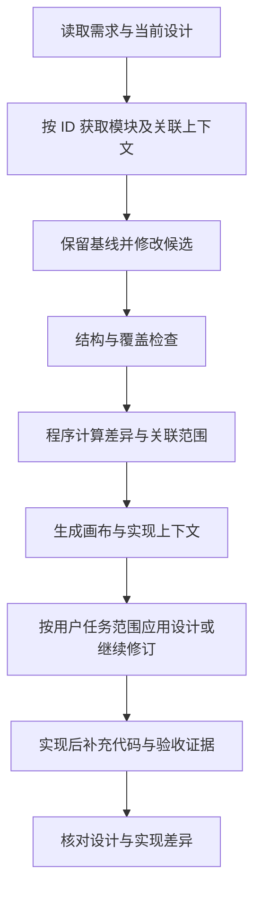

# Skill 与迭代流程

> 2026-11-13：当前已交付 Skill 1.0，有界 query、程序 diff、基线/候选 apply 和独立安装已落地。实际操作以 [SKILL.md](../skills/arkigo/SKILL.md) 与 [验收记录](./07-Skill验收.md) 为准；下文未列为当前实现的完整导入、持续证据与 MCP 等仍是长期候选。

## Skill 的职责

Skill 名称为 `arkigo`。它指导 AI 生成、读取和维护设计；确定性的数据校验、差异计算和渲染由配套程序完成。

Skill 的主文件应短小，说明触发条件、任务路由、共同原则和完成标准；具体协议、示例和修复方法按任务读取。不要让每次使用都加载所有图种、整个项目和全部历史。

建议触发描述：当用户希望把产品想法整理成可实施的系统设计，理解已有 Web 项目的结构与规则，或维护可视化设计及迭代变化时使用。普通的小代码修改不必强制建立整套设计工作区。

## 当前版本如何工作

以“帮我设计登录模块”为例，Skill 执行：

1. 从对话提取这一轮的目标和限制，只澄清会改变核心方案的未知信息。
2. 生成系统、模块、一条主要流程、必要规则和验收；未决定的信息保留为问题，AI 建议标为 `proposed`。
3. 默认写入项目 `docs/canvas.json`，调用 render 校验并生成 `docs/canvas.html`；已有模型也可直接渲染。错误按对象 ID 和字段路径修复。
4. 给用户简短说明：设计包含什么、有哪些待决策问题。用户不需要手工编辑 JSON；模型文件供后续会话继续读取。

修改设计时保存基线与候选，由 `diff` 计算字段变化，`apply` 校验并检查基线后应用；读取设计由 `query` 按模块、节点与字段提取，并限制单次项数/字节量、说明分页与省略。尚无自动业务影响推断或完整实施上下文包。

轻量要求落在三处：主文件只保留任务入口和共同约定，详细参考按需读；设计只展开当前这一轮；程序承担可确定的校验和比较。当前已完成 Schema、validate、query、diff、apply、公共 HTML 渲染器与安装器；两种入口的早期样例见 [POC](./poc/README.md)，独立任务验收见 Skill 记录。宿主自动触发与长期使用效果仍需真实会话观察。

## 五种任务路径

> 2026-11-12：按用户的新方向，[起步范围](./00-起步范围.md)先验证“新建设计”和“理解已有系统”两条入口，共用最小只读画布。下表为长期路径；其中 query/diff 与候选应用已完成，完整导入、自动业务影响推断与持续证据核验未实现。

| 路径 | 输入 | 输出 |
| --- | --- | --- |
| 新建设计 | 想法、角色、目标、约束 | 初始模型、可视化草案、待决策问题 |
| 导入现状 | 已有代码、说明、原型 | 有来源的现状记录及设计草案，区分事实与推测 |
| 修改设计 | 当前模型和新需求 | 候选设计、差异、相关影响及验收变化 |
| 准备实现 | 模块或变更 ID | 有边界的实现上下文和代码定位线索 |
| 核对实现 | 模型、代码版本、验证记录 | 匹配项、缺口和失效证据 |

## 新建设计

1. 提取用户、目标、范围、关键路径与约束，保留用户原话的来源。
2. 为核心模块定义职责和边界，先完成一条从输入到结果的流程。
3. 识别分支、失败、权限、数据归属以及需要时的并发和重试规则。
4. 把未知决定建成问题对象，并关联受影响的流程或规则。低影响细节可保留为有标签的假设；阻碍核心方案的决定需向用户澄清。
5. 建立正常路径和关键异常的验收对象，避免“功能正常”“异常合理处理”等不可核对表述。
6. 校验模型，生成可阅读草案与问题摘要。将 AI 建议保留为 `proposed`，不默认为用户接受。

初稿应完整覆盖当前要做的一轮工作，不需要一次设计所有未来功能。

## 导入已有项目

先阅读项目说明、清单和入口，再沿目标行为跟踪调用、状态及数据读写。按相关范围取证，不将整个目录结构直接复制成系统设计。

记录代码版本或文件快照身份。目录名、注释和 README 是线索；关键行为应找到实际执行位置。规则的“为什么”可能无法从代码推断，应作为问题交给用户补充。

导入结果至少区分三种内容：已观察到的行为、原有文档声称的设计、AI 推测的解释。冲突应显式显示，不能让 AI 自动改写用户设计以迎合当前代码。

## 一次迭代的处理



有明确修改授权时直接推进，不额外要求逐节点确认。用户只要求比较方案时保留候选；重大需求仍不明确时保留问题，不把猜测写成已经确定的约束。

更改规则时同步查找其验收、受约束流程和证据；仅修改相关对象。输出的“影响”必须附关系路径，并注明它是设计图可推导的关联，不保证覆盖全部运行影响。

## 给 AI 的局部上下文

目标是让新会话不必重读整个仓库，也能了解当前修改的边界。按模块提取的包建议包含：

- 项目与模型版本、目标模块 ID、简短全局目标。
- 模块职责、必要子对象、规则、验收和未决问题。
- 直接依赖与被依赖关系、共享规则，以及筛选原因。
- 代码规划位置、已观察的源码证据、失效项。
- 当前变更和前后差异。
- 被省略的对象数量、索引入口与扩展阅读建议。

预算不足时先缩短次要说明，保留关键规则和问题；不能静默截断后仍声称上下文完整。关系未知也应明确说明。上下文包是可再生成的投影，用户项目的模型才是内容来源。

## 完成标准

设计生成完成意味着模型结构有效、目标范围已表达、未知项已标记、图和数据一致。它不表示设计没有遗漏，也不表示代码已实现。

准备实现完成意味着当前范围的关键决定足够明确、验收可执行、AI 有代码入口和依赖说明；未决项可以存在，但不能阻塞此次实现。

核对完成意味着检查结果与具体设计内容和代码版本关联，无法检查的部分有明确说明。只有实际执行过的验证才产生通过证据，验收文字本身不是测试结果。

## 未来 Skill 包结构

```text
skills/arkigo/
  SKILL.md
  references/
    new-design.md
    import-existing.md
    update-design.md
    evidence-and-validation.md
  schemas/                    # 版本化协议
  examples/                   # 经过校验的小型样例
  scripts/                    # 可直接调用的工具入口
  assets/                     # 画布静态资源
```

这是长期包布局建议。当前实际安装包包含 `SKILL.md`、按需 references、schemas、scripts 和 assets，不携带 POC、测试或开发产物；测试保留在开发仓库。主 Skill 应引用同一套模型协议，避免每个 Agent 的接入文案发展成互不兼容的数据格式。
