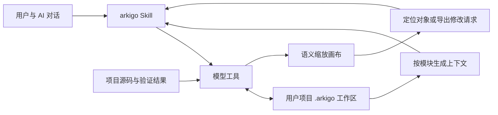

# 技术架构与实施路线

## 总体分工

首版建议采用本地文件工作区、轻量命令行工具和浏览器画布。用户现有的 AI 编程工具运行 Skill，不需要 ArkiGo 再内置一个大模型账号、聊天系统或云服务。

模型工具负责加载、校验、比较、更新、取证和生成；画布负责投影、导航与比较；Skill 负责需求理解、判断和调用。未来 MCP 只包装这些能力，不另造一套模型。

## 模块划分

| 模块 | 输入输出和责任 |
| --- | --- |
| 模型核心 | 解析模型、校验 ID 与关系、遍历归属树和关联图 |
| 更新与差异 | 校验基线、生成候选差异、保存回执、原子更新 |
| 视图投影 | 根据焦点、显示密度和筛选，输出可见对象及带来源的聚合连接 |
| 代码与证据 | 处理规划位置、文件观察、版本和内容指纹、验收记录 |
| 上下文提取 | 按目标对象及预算生成带遗漏说明的上下文 |
| 画布阅读器 | 缩放、进入模块、搜索、详情、版本对比与无障碍导航 |
| 导出适配 | 生成可搬运的阅读页面；未来可导出 Archify 等格式 |

## 技术建议与选择依据

共享模型逻辑建议使用 TypeScript，模型存储使用 JSON，正式协议使用 JSON Schema；构建后向 Skill 提供 Node 可运行入口。此选择主要为了浏览器和工具共用类型与校验，不是用户项目必须采用的技术栈。

画布先做一个技术验证：使用 React + React Flow 验证嵌套节点、交互和 DOM 内容，使用独立的语义投影层控制展开与关系聚合。React Flow 的普通缩放不自动提供语义缩放；核心逻辑必须由 ArkiGo 实现。

如果节点规模或嵌套体验不满足样例，再比较自定义 SVG 或其他画布引擎。当前不因“无限画布”这个名字就引入复杂渲染栈。最终选择以第三阶段原型结果为准。

第一版生成可本地打开的阅读页面，将模型和视图嵌入页面或通过明确的导入入口加载，避免 `file://` 下跨文件请求限制。浏览器不宣称能直接写任意项目文件；第一版修改仍由 Skill 完成。媒体使用可搬运相对资源，重资源不强制嵌入一个 HTML。

未来本地编辑器可通过本机服务或用户选择的文件权限写入，但必须调用同一模型更新逻辑。无需为首版提前部署后端和数据库。

## 建议的工具能力

下列名称用于划定职责，尚不是可执行命令：

| 能力 | 行为 |
| --- | --- |
| `validate` | 结构检查及覆盖诊断，返回对象 ID 与字段路径 |
| `render` | 根据模型和视图生成画布阅读页面 |
| `diff` | 比较设计与布局，输出结构化差异 |
| `context` | 获取目标模块、关联规则及证据 |
| `inspect-code` | 核验已有映射，不凭空宣称已理解整个代码库 |
| `apply` | 在基线未变化时应用候选并记录版本 |

以后提供 MCP 时，可以包装为 `get_module`、`get_context`、`propose_change`、`apply_change` 等工具。是否提供远程服务、跨项目查询或协作，等真实使用需要出现后再决定。

## 实施阶段与完成条件

> 2026-11-12：当前按[起步范围](./00-起步范围.md)的五个步骤推进。它覆盖下面阶段 1 的大部分和阶段 2 的一部分，阶段 3 和阶段 4 已推迟；工具先用无构建步骤的 Node 脚本，不引入 TypeScript。

### 阶段 0：把设计约定具体化

当前阶段产物是本目录文档和登录变更样例。先检查样例能否表达层级、分支、规则、待定问题、验收和一次迭代。当前只验证文档与样例的一致性。

### 阶段 1：模型与工具

实现正式 Schema、结构校验、对象查询、语义差异和基线检查。使用小型案例验证：重复 ID、循环归属、悬空引用、规则变更、重命名保留身份、纯布局变化和过期基线。

完成条件：无需画布，也能从两个模型准确回答“改了什么”“相关对象是什么”“哪些地方未知”。

### 阶段 2：Skill 工作方法

编写 `skills/arkigo/SKILL.md` 和必要参考材料。用一份模糊需求生成模型，再用一个真实现有项目导入局部设计，检验 AI 是否保留未知、准确指向源码、避免每次重建整个设计。

完成条件：两个独立会话能够读取同一工作区，保持对象身份并连续完成一次变化。

### 阶段 3：语义缩放画布

实现三种密度、容器内展开、跨模块连接聚合、面包屑、搜索和变更展示。可以在阶段 1 完成最小模型后并行开展原型开发，但协议修改需同步样例。

完成条件：登录案例从概览到规则可连续阅读；关系可追溯；布局变化不会伪装成逻辑变化；真实浏览器中检查可读性与键盘操作。

### 阶段 4：设计与代码核对

加入规划位置、文件摘要、符号线索和验收结果。代码和规则变更后，相关证据进入待复核状态。

完成条件：能演示“设计已更新，但代码尚无依据”和“旧测试通过，但规则改变需复核”，而不会出现虚假的整体已完成标记。

### 阶段 5：在实际项目中迭代

挑选用户已有的一个小系统和一个较复杂系统，完成真实需求修改。观察理解成本、遗漏、错误定位和版本维护成本，再决定优先补画布编辑、接口模型、状态机还是 MCP。

## 验证策略

对数据核心使用少量有实际语义的自动测试，尤其覆盖引用、版本、差异和证据失效。画布使用真实浏览器的缩放、导航和视觉检查；仅检查生成 HTML 存在并不能证明语义缩放成立。

业务验证与画布验证分开：画布正确显示一个流程，不等于该流程的业务设计正确。设计完整性通过具体场景和异常案例评审；实现正确性通过用户项目的适当测试确认。

## 当前保留的设计决策

| 决策 | 当前建议 | 重新考虑的触发条件 |
| --- | --- | --- |
| 初始编辑方式 | 对话和 Skill 更新模型 | 真实用户反复需要直接拖拽和改规则 |
| 存储方式 | JSON 文件与轻量设计快照 | 多人并发或大型项目的查询成本明显增加 |
| 画布引擎 | 先验证 React Flow | 嵌套或性能无法满足语义缩放原型 |
| Archify 关系 | 参考流程，可选导出适配 | 明确需要其图种、分享或导出能力 |
| MCP | 后置 | 多个客户端需要稳定读写独立工作区 |

下一步最小开发任务是[起步范围](./00-起步范围.md)的步骤 1：把登录样例变成可校验模型。画布原型推迟到起步版试用之后。
